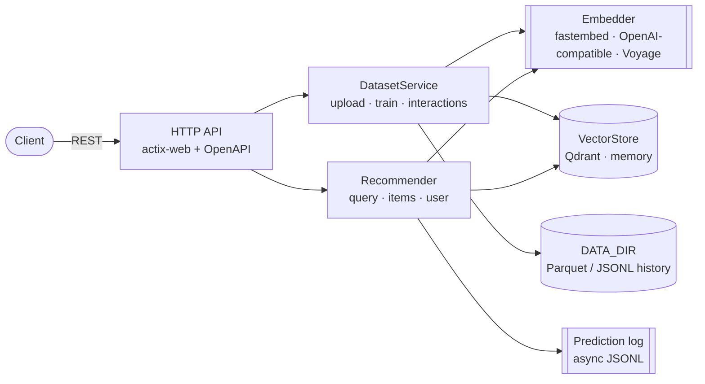

# Recommendation Service

[](https://github.com/101t/recom_service/actions/workflows/ci.yml)
[](LICENSE)


A self-hosted recommendation API written in Rust. Upload a catalog (CSV, JSON, Parquet, …),
and get recommendations by **free text in 100+ languages**, by **example items** ("more like
this") or **per user** from their interactions — filtered, paginated and diversified.
[Qdrant](https://qdrant.tech) stores the vectors; embeddings run **in-process** with a
multilingual model, so the whole stack is one container plus Qdrant.

```
POST /api/v1/datasets/shop/recommend   {"query": "zapatillas para correr", "limit": 3}
→ Winter Running Tights · Running Shoes Pro · Trail Blazer Boots          (English catalog, Spanish query)
```

## Contents

- [Features](#features)
- [Quick start](#quick-start)
- [Concepts](#concepts)
- [API](#api)
- [Embedding models](#embedding-models)
- [Configuration](#configuration)
- [Architecture](#architecture)
- [Deployment and scaling](#deployment-and-scaling)
- [Development](#development)
- [CI/CD](#cicd)
- [Upgrading from 0.2](#upgrading-from-02)

## Features

- **Train from your data** — upload CSV, TSV, JSON (array or lines), NDJSON or Parquet, or send
  items as JSON. Id and text columns are detected automatically; every other column becomes
  filterable metadata. Uploads are idempotent (stable ids), so re-uploading updates items.
- **Multilingual by default** — `intfloat/multilingual-e5-small` runs in-process via
  [fastembed](https://github.com/Anush008/fastembed-rs) (ONNX Runtime). Queries and items can be in
  different languages. Switch to larger multilingual models, or to any OpenAI-compatible API
  (OpenAI, Ollama, vLLM, Hugging Face TEI, LiteLLM) or Voyage AI with one variable.
- **Every recommendation style in one call** — text query, positive/negative example items, a
  user's profile, or any combination; `average_vector`, `best_score` and `sum_scores`
  strategies; Qdrant-style filters (`must`/`should`/`must_not`, match, any, except, range);
  pagination; score threshold; MMR **diversity**.
- **Real-time personalization** — interactions (views, purchases, ratings, dislikes) update a
  user's profile immediately; items they already saw are excluded automatically.
- **Built for Qdrant 1.19** — gRPC client, multitenant collections with a tenant payload index,
  Query API (`recommend`, MMR), optional int8 quantization, payload indexes, sharding/replication.
- **Retrain any time** — raw data is kept as Parquet/JSONL; `POST /datasets/{id}/train` rebuilds the
  index (e.g. after switching models) from the stored history.
- **Operable** — OpenAPI + Swagger UI, Prometheus metrics, JSON logs with request ids,
  liveness/readiness probes, optional API key, graceful shutdown, prediction logs exportable
  as CSV/Parquet/JSONL, non-root multi-arch Docker image.
- **Extensible** — `Embedder` and `VectorStore` are small traits; an in-memory store and a
  deterministic hash embedder make the whole API testable without any infrastructure.

## Quick start

```bash
git clone https://github.com/101t/recom_service && cd recom_service
docker compose up -d --build --wait     # or: make up
```

The first start downloads the embedding model (~450 MB) into a volume. Then open
<http://localhost:8000/docs/> for the interactive API docs.

> Prefer a prebuilt image? CI publishes `ghcr.io/101t/recom_service` (`:edge` for `main`,
> `:latest` and `:X.Y.Z` for releases) for `linux/amd64` and `linux/arm64`.

**1. Train: upload a catalog** (creates the dataset `shop`):

```bash
curl -F file=@e2e/data/products.csv \
  "http://localhost:8000/api/v1/datasets/shop/items/upload?wait=true"
```

Without `wait=true` the upload returns `202 Accepted` immediately and indexing runs in the
background; poll `GET /api/v1/datasets/shop` until `status` is `ready`.

**2. Predict: ask for recommendations** — in any language:

```bash
curl -X POST http://localhost:8000/api/v1/datasets/shop/recommend \
  -H 'content-type: application/json' \
  -d '{"query": "سماعات لاسلكية", "limit": 3}'
```

```json
{
  "prediction_id": "6c0f7a9e-…",
  "dataset_id": "shop",
  "recommendations": [
    {"id": "4",  "score": 0.829, "payload": {"name": "Wireless Noise-Canceling Headphones", "category": "electronics", "price": 279.99, "in_stock": true, "…": "…"}},
    {"id": "12", "score": 0.822, "payload": {"name": "Portable Bluetooth Speaker", "…": "…"}},
    {"id": "19", "score": 0.820, "payload": {"name": "Resistance Bands Set", "…": "…"}}
  ],
  "latency_ms": 9
}
```

**3. More like this, with a filter:**

```bash
curl -X POST http://localhost:8000/api/v1/datasets/shop/recommend \
  -H 'content-type: application/json' \
  -d '{
        "item_ids": ["1"],
        "filter": {"must": [{"key": "price", "range": {"lte": 150}}],
                   "must_not": [{"key": "in_stock", "match": {"value": false}}]},
        "limit": 5
      }'
```

**4. Personalize:** record what a user did, then recommend for them:

```bash
curl -X POST http://localhost:8000/api/v1/datasets/shop/interactions \
  -H 'content-type: application/json' \
  -d '{"interactions": [
        {"user_id": "u42", "item_id": "4",  "event_type": "purchase", "weight": 3},
        {"user_id": "u42", "item_id": "12", "event_type": "view"}
      ]}'

curl -X POST http://localhost:8000/api/v1/datasets/shop/recommend \
  -H 'content-type: application/json' -d '{"user_id": "u42", "limit": 5}'
```

No Docker? `make dev` runs the service with an in-memory store and a hash embedder (no
downloads), and `make qdrant && make run` runs it natively against Qdrant.

## Concepts

**Dataset** — an isolated catalog (`products`, `articles`, …). Created explicitly with
`POST /api/v1/datasets`, or implicitly by the first upload. Ids use `[A-Za-z0-9_-]`.

**Items** — rows of your catalog. The service needs:

| | Configured with | Auto-detected from |
|---|---|---|
| Item id | `id_column` | `id`, `item_id`, `product_id`, `sku`, `uuid`, … (otherwise a content hash) |
| Text to embed | `text_columns` | `title`, `name`, `text`, `content`, `description`, `summary`, `category`, `tags`, … |

All columns (including nested JSON) are stored as the item payload, returned with
recommendations and usable in filters. Detected settings are saved on the dataset so later
uploads stay consistent.

**Training** — every upload is stored (Parquet for files, JSONL for API batches) and then
embedded and indexed in batches. Dataset `status` moves `pending → training → ready` (or
`failed`, with `error`; previously indexed data stays queryable), with `progress` while running.
`POST /api/v1/datasets/{id}/train` replays the stored history into the index, e.g. after you
change the embedding model; `reset=true` clears the old vectors first.

**Interactions and user profiles** — each interaction adds the item's vector, scaled by
`weight` (default 1, negative for dislikes), to the user's profile. Profiles update in real
time; bulk history can be uploaded as a file with `user_id`/`item_id` columns (aliases such
as `customer_id`, `product_id`, `sku`, `rating` are understood). Recommending for a user
searches around their profile and skips their recent items (`USER_PROFILE_MAX_ITEMS`).

**Recommendation request** (`POST /api/v1/datasets/{id}/recommend`):

| Field | Meaning |
|---|---|
| `query` | Free text, any language the model supports |
| `item_ids` / `negative_item_ids` | "More like these" / "less like those" |
| `user_id` | Personalize from recorded interactions (404 if the user has none and no other signal is given) |
| `strategy` | `average_vector` (default), `best_score`, `sum_scores` — how multiple examples combine |
| `filter` | `must` / `should` / `must_not` conditions with `match: {value \| any \| except}` or `range: {gt, gte, lt, lte}`; `min_should_count`; dotted keys for nested fields |
| `limit`, `offset` | Pagination (defaults 10 / 0) |
| `score_threshold` | Minimum similarity |
| `diversity` | 0–1; re-ranks with Maximal Marginal Relevance to reduce near-duplicates |
| `exclude_seen` | Skip the user's recent items (default `true`) |
| `with_payload` | Include item payloads (default `true`) |

Every response carries a `prediction_id`. Send it back with interactions
(`"prediction_id": …`) to attribute clicks and purchases; predictions are logged and can be
exported for offline evaluation.

Errors always look like `{"error": {"code": "not_found", "message": "dataset 'x' not found"}}`.

## API

Interactive docs: `/docs/` · OpenAPI document: `/api-docs/openapi.json`

| Method & path | Purpose |
|---|---|
| `GET /health`, `GET /ready` | Liveness and readiness (Qdrant reachable) probes |
| `GET /metrics` | Prometheus metrics |
| `GET /api/v1/info` | Model, dimension, vector store and collection stats |
| `GET /api/v1/models` | Embedding models available to the built-in provider |
| `POST /api/v1/datasets` | Create a dataset with explicit settings |
| `GET /api/v1/datasets` · `GET/DELETE /api/v1/datasets/{id}` | List, inspect, delete |
| `POST /api/v1/datasets/{id}/items/upload` | Upload a catalog file (multipart field `file`; `?wait=true`) |
| `POST /api/v1/datasets/{id}/items` | Add/update up to 10 000 items as JSON |
| `GET/DELETE /api/v1/datasets/{id}/items/{item_id}` | Read or remove one item |
| `POST /api/v1/datasets/{id}/interactions` | Record interactions (real-time) |
| `POST /api/v1/datasets/{id}/interactions/upload` | Upload interaction history |
| `POST /api/v1/datasets/{id}/train` | Rebuild the index from stored data (`?wait=true&reset=true`) |
| `POST /api/v1/datasets/{id}/recommend` | Get recommendations |
| `GET /api/v1/predictions` · `GET /api/v1/predictions/export?format=csv\|parquet\|jsonl` | Prediction logs |

Set `API_KEY` to require `X-API-Key: <key>` (or `Authorization: Bearer <key>`) on `/api/v1/*`.

## Embedding models

The default provider runs models in-process. Any of these work with `EMBEDDING_MODEL`
(Hugging Face id or alias; `GET /api/v1/models` lists all, including English-only ones):

| Model | Dim | Download | Notes |
|---|---|---|---|
| `intfloat/multilingual-e5-small` | 384 | ~450 MB | **Default.** ~100 languages, fast on CPU |
| `intfloat/multilingual-e5-base` | 768 | ~1.1 GB | Better quality, slower |
| `Qdrant/multilingual-e5-large-onnx` | 1024 | ~2.2 GB | Best E5 quality |
| `Xenova/paraphrase-multilingual-MiniLM-L12-v2` | 384 | ~450 MB | Sentence similarity, 50+ languages |
| `Qdrant/paraphrase-multilingual-MiniLM-L12-v2-onnx-Q` | 384 | smaller | Quantized variant of the above |
| `Xenova/paraphrase-multilingual-mpnet-base-v2` | 768 | ~1.1 GB | |
| `BAAI/bge-m3` | 1024 | ~2.2 GB | Strong multilingual retrieval, long inputs |
| `onnx-community/embeddinggemma-300m-ONNX` | 768 | ~1.2 GB (quantized variants ~0.3 GB) | 100+ languages |

Query/document prefixes that models expect (`query:`/`passage:` for E5, task prompts for
EmbeddingGemma, …) are applied automatically; override them with `EMBEDDING_QUERY_PREFIX`
and `EMBEDDING_DOCUMENT_PREFIX`.

Remote providers:

```bash
# OpenAI
EMBEDDING_PROVIDER=openai EMBEDDING_MODEL=text-embedding-3-small EMBEDDING_API_KEY=sk-...
# Ollama, vLLM, Hugging Face TEI, LiteLLM, ... (any OpenAI-compatible /embeddings endpoint)
EMBEDDING_PROVIDER=openai EMBEDDING_API_BASE=http://localhost:11434/v1 EMBEDDING_MODEL=bge-m3
# Voyage AI
EMBEDDING_PROVIDER=voyage EMBEDDING_MODEL=voyage-3.5 EMBEDDING_API_KEY=...
```

**Changing models** changes the vector space (and often the dimension). Point the service at
new collections with a new `QDRANT_COLLECTION_PREFIX`, start it, and call
`POST /api/v1/datasets/{id}/train?wait=true` for each dataset — the stored raw data is
re-embedded with the new model. The service refuses to start if the existing collections
have a different dimension than the model.

## Configuration

Everything is configured through environment variables (a `.env` file is read too). See
[`.env.example`](.env.example) for the complete, commented list. The most important ones:

| Variable | Default | Description |
|---|---|---|
| `PORT` / `HOST` | `8000` / `0.0.0.0` | Listen address |
| `API_KEY` | – | Require an API key on `/api/v1/*` |
| `DATA_DIR` | `./data` (`/data` in Docker) | Dataset snapshots, uploads, prediction logs |
| `VECTOR_STORE` | `qdrant` | `qdrant` or `memory` (development/tests) |
| `QDRANT_URL` | `http://localhost:6334` | Qdrant **gRPC** endpoint |
| `QDRANT_API_KEY` | – | Qdrant API key |
| `QDRANT_COLLECTION_PREFIX` | `recom` | Collections `{prefix}_items`, `{prefix}_users` |
| `QDRANT_QUANTIZATION` | `none` | `int8` cuts vector memory ~4× |
| `QDRANT_PAYLOAD_INDEXES` | – | e.g. `category:keyword,price:float` for faster filters |
| `EMBEDDING_PROVIDER` | `fastembed` | `fastembed`, `openai`, `voyage`, `hash` |
| `EMBEDDING_MODEL` | `intfloat/multilingual-e5-small` | Model id |
| `EMBEDDING_CACHE_DIR` | `$DATA_DIR/models` (`/models` in Docker) | Downloaded models |
| `EMBEDDING_POOL_SIZE` / `EMBEDDING_THREADS` | `1` / all cores | In-process inference concurrency |
| `TRAINING_BATCH_SIZE` | `256` | Items embedded and written per batch |
| `TRAINING_MAX_CONCURRENT_JOBS` | `2` | Background jobs running at once |
| `MAX_UPLOAD_MB` | `512` | Upload size limit |
| `LOG_FORMAT` / `RUST_LOG` | `pretty` / `info` | `json` for log shippers |

## Architecture



- **Qdrant layout:** one items collection and one users collection shared by all datasets,
  partitioned by a tenant-indexed `_dataset` field (Qdrant's recommended multitenancy). Point
  ids are UUIDv5 of `(dataset, item_id)`, so writes are idempotent and items can be fetched by id.
- **User profiles** are stored as vectors in the users collection; a recommendation for a user
  is a nearest-neighbour search around the profile, excluding their recent items.
- **Raw data** under `DATA_DIR/datasets/{id}/` is the source of truth the index can be rebuilt
  from: `items/*.parquet|jsonl|deletes.json` (ordered by time) and `interactions/*.jsonl`.

## Deployment and scaling

- **Read path** (`recommend`) is stateless: run as many replicas as you need behind a load
  balancer. Each replica embeds queries locally (about 10 ms on CPU with the default model).
- **Write path** (uploads, training, interactions) keeps raw data in `DATA_DIR`. With several
  replicas, mount the same `ReadWriteMany` volume (NFS, EFS, Filestore…). Background jobs run on
  the replica that accepted the upload; if it restarts mid-job the dataset is marked `failed`
  with instructions to retrain.
- **Qdrant**: use a cluster with `QDRANT_SHARD_NUMBER` / `QDRANT_REPLICATION_FACTOR`, enable
  `QDRANT_QUANTIZATION=int8` for large catalogs, and add `QDRANT_PAYLOAD_INDEXES` for fields
  you filter on. Payloads are stored on disk by default.
- **Embedding throughput**: in-process inference is CPU-bound. Tune `EMBEDDING_THREADS` and
  `EMBEDDING_POOL_SIZE`, or move embeddings to a GPU server (e.g. Hugging Face TEI) via the
  `openai` provider.
- **Kubernetes**: liveness `GET /health`, readiness `GET /ready`, and a generous startup probe
  on first boot (model download) — or build with `--build-arg PRELOAD_MODEL=true` to bake the
  model into the image for offline/air-gapped clusters.
- **Security**: set `API_KEY`, restrict `CORS_ALLOWED_ORIGINS`, terminate TLS at your ingress,
  and keep Qdrant on a private network (or set `QDRANT_API_KEY`). `/health`, `/ready`,
  `/metrics` and `/docs/` stay unauthenticated for probes and scrapers: don't expose them
  publicly, or turn off `SWAGGER_UI_ENABLED` / `METRICS_ENABLED`.
- **Observability**: Prometheus metrics at `/metrics` (`recom_http_requests_total`,
  `recom_http_requests_duration_seconds` per route), structured logs with `LOG_FORMAT=json`.

## Development

```bash
make help        # list all targets
make dev         # run with in-memory store + hash embedder (no downloads, no Docker)
make test        # unit + API tests (hermetic)
make lint        # clippy, warnings as errors
make e2e         # build image, start Qdrant + service, run the black-box suite, tear down
```

Tests come in three layers:

| Layer | Where | Needs |
|---|---|---|
| Unit tests | `src/**` | nothing |
| API tests: full HTTP stack, in-memory store, hash embedder | `tests/api.rs` | nothing |
| End-to-end: black-box HTTP against Qdrant + the real model, incl. multilingual checks | `e2e/` | a running stack (`make e2e`), or `E2E_BASE_URL` for any deployment |

See [CONTRIBUTING.md](CONTRIBUTING.md) for the code layout and how to add an embedding
provider, a vector store or an endpoint.

## CI/CD

[`.github/workflows/ci.yml`](.github/workflows/ci.yml) runs on every push and pull request:

1. `cargo fmt --check` and `cargo clippy -D warnings`
2. unit + API tests, and a build without the `fastembed` feature
3. builds the Docker image, starts it with Qdrant via `docker compose`, runs the e2e suite
4. on `main` and `v*` tags only, after all of the above pass: builds `linux/amd64` and
   `linux/arm64` images natively and publishes a multi-arch manifest to
   `ghcr.io/<owner>/<repo>` (`:edge`, `:sha-…`, and `:X.Y.Z`, `:X.Y`, `:latest` for releases)

Dependabot keeps Cargo, Docker and Actions dependencies up to date.

## Upgrading from 0.2

0.3 is a rewrite; the API changed:

| 0.2 | 0.3 |
|---|---|
| `POST /api/v1/datasets/upload?dataset_id=…&text_column=…` | `POST /api/v1/datasets/{id}/items/upload?text_columns=…` |
| `GET /api/v1/datasets/jobs/{job_id}` | `GET /api/v1/datasets/{id}` (`status`, `progress`) |
| `POST /api/v1/recommend` with `dataset_id` in the body | `POST /api/v1/datasets/{id}/recommend` |
| `filters` (flat map) | `filter` (Qdrant-style; see above) |
| `/api/v1/collections` CRUD | Collection stats in `GET /api/v1/info`; collections are managed by the service |
| `GET /api/v1/health` | `GET /health` and `GET /ready` |
| `QDRANT_HOST` / `QDRANT_PORT` | `QDRANT_URL` (old variables still accepted) |
| `USE_LOCAL_EMBEDDER`, external FastEmbed HTTP service | In-process `EMBEDDING_PROVIDER=fastembed` (default) |
| `DATASET_STORAGE_PATH`, `PREDICTION_LOG_PATH` | `DATA_DIR` |

Vectors indexed by 0.2 are not reused: upload your datasets again (they are re-embedded with
the multilingual model).

## License

[MIT](LICENSE)
